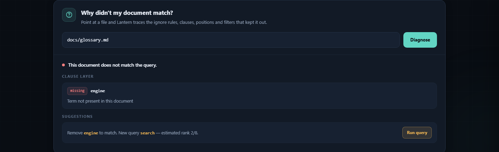

# Lantern

**A zero-dependency, explainable, local full-text search engine — written with the Go standard library only.**

[中文说明](README.zh-CN.md) · Go ≥ 1.22 · No third-party modules · No network calls


---

## Why Lantern

- **Segmented inverted index** — immutable segments, atomic manifest commits, crash-safe recovery, MVCC snapshots and tiered merging.
- **BM25F ranking** — cross-segment statistics, per-field weights, optional recency boost.
- **Rich query language** — `AND` / `OR` / `NOT`, `"phrases"`, `"proximity"~n`, `field:`, `prefix*`, `fuzzy~`, and `ext:` / `size:` / `mtime:` filters.
- **Explain** — every hit can be expanded into a term-by-term score breakdown; the sum of contributions equals the final score within `1e-9` (enforced by tests).
- **Why-not** — explains why a *specific* document did not match (ignore rules, encoding, nearest terms, phrase order/gap, `NOT` clauses, failed filters) and suggests which clause to remove.
- **CJK and code friendly** — Chinese bigrams plus single-character containment, `camelCase` / `snake_case` subwords, full-width folding.
- **Built-in web UI** — a single embedded HTML file with English/Chinese switch, dark/light themes, live search, score breakdown, document viewer and the why-not panel. Zero external assets.



---

## Install

```bash
go build -o lantern ./cmd/lantern      # or: make build  ->  bin/lantern
```

`go.mod` contains only `module` and `go` directives — no `require`, nothing to download.

## Quick start

```bash
lantern index docs                    # scan & incrementally index (--workers N --max-size 2MB --no-store-body)
lantern search "search engine"        # boolean AND, ranked by BM25F
lantern search '"http request"'       # phrase matches parseHTTPRequest (identifier subwords)
lantern search "title:lantern pre* fuzzy~ ext:md size:<1mb mtime:>2025-01-01"
lantern search "release" --explain    # term-by-term score breakdown
lantern why-not "release" docs/a.md   # explain why a.md did not match
lantern stats                         # docs / terms / segments / disk usage / average field lengths
lantern check                         # verify segment CRCs and manifest consistency
lantern compact                       # force-merge into a single segment
lantern serve --addr 127.0.0.1:7700   # HTTP API + embedded web UI at http://127.0.0.1:7700/
lantern watch docs --interval 2s      # polling incremental updates (Ctrl-C to exit gracefully)
```

The index lives in `./.lantern` by default; override it with `--index <dir>` or `LANTERN_DIR`.
Document paths are relative to the **parent directory of the index**. Exit codes: `0` success,
`1` runtime error, `2` usage / query syntax error (with a column indicator).

> `serve` opens the index once at startup. If another process re-indexes or compacts the same
> directory, restart `serve` to pick up the new manifest generation.

## Query syntax

| Form | Example | Meaning |
| --- | --- | --- |
| Implicit / explicit AND | `alpha beta`, `alpha AND beta` | both clauses required |
| OR / NOT | `alpha OR beta`, `-draft`, `NOT draft` | union / exclusion |
| Phrase | `"inverted index"` | adjacent terms, in order |
| Proximity | `"release notes"~3` | terms within a 3-position window |
| Field | `title:alpha`, `body:release`, `path:docs` | restrict to one field |
| Prefix | `parse*` | prefix expansion |
| Fuzzy | `releas~`, `releas~/1`, `releas~/2` | edit-distance expansion |
| Filters | `ext:md`, `size:>1mb`, `size:<=10kb`, `mtime:>2025-01-01`, `mtime:2025-06` | metadata filter |

CJK text is indexed as overlapping bigrams plus single characters, so `搜索引擎`,
single `擎`, and mixed `Go语言并发` queries all work. Multi-character CJK sequences are
evaluated as bigram phrases; per design decision D13 phrases contribute `0` to the score,
so phrase-only queries are ordered by path. Single-character and Boolean CJK queries are
scored normally.

## CLI reference

| Command | Key flags |
| --- | --- |
| `index <dir...>` | `--workers N`, `--max-size 2MB`, `--no-store-body` |
| `watch <dir...>` | `--interval 2s`, `--workers N`, `--max-size 2MB`, `--no-store-body` |
| `search "<query>"` | `-n 10`, `--json`, `--explain`, `--no-color`, `--recency 0.2`, `--half-life 30d` |
| `why-not "<query>" <path>` | `--json` |
| `serve` | `--addr 127.0.0.1:7700` |
| `stats` / `check` / `compact` | — |
| `help` | — |

Global: `--index <dir>` / `LANTERN_DIR`. Flags may appear at any position and use either
`-flag` or `--flag`. Invalid numeric values (for example `-n 0` or `-n --json`) are rejected
with exit code `2` instead of silently falling back to a default.

## HTTP API

All endpoints are **read-only** and accept `GET` / `HEAD` only; other methods return `405`
with an `Allow` header.

```
GET /api/search?q=&n=&explain=1     # hits + snippets + highlights + optional explain
GET /api/why-not?q=&path=           # structured diagnosis
GET /api/doc?path=                  # stored body, only for paths already in the index
GET /api/stats                      # docs / terms / segments / bytes / avg_len
GET /healthz                        # {"status":"ok"}
GET /                               # embedded web UI
```

`/api/search` accepts `n` in `1..100` (default `10`), `explain=1` or `explain=true`, and
returns `took_ms`. Highlight offsets are UTF-16 code-unit offsets, ready for
`String.prototype.slice` — correct for CJK and emoji alike.

## Web UI

Open `http://127.0.0.1:7700/` after `lantern serve`. The interface is a single embedded
HTML file with no external requests (enforced by a CI check).

- Language switch (EN / 中文) and dark / light theme, both persisted locally.
- Live search (140 ms debounce), stale-response cancellation, skeleton / empty / error states.
- Highlighted snippets, per-term score bars, a document viewer, and keyboard navigation
  (`/` focus, `↑` `↓` select, `Enter` expand, `Esc` close).
- Structured why-not diagnosis with a one-click "Run query" suggestion.

Useful deep links: `?lang=en|zh`, `?theme=dark|light`, `?q=<query>`, `?wn=<path>`,
`?open=1` (expand the first breakdown), `?scroll=diagnose`.

## Design notes

- **Immutable segments + atomic manifest rename** — a commit is one `rename`; after a crash
  the index reopens as either the old or the new generation (fault injection at every step).
- **Matching and scoring are separate** — iterator trees (leapfrog / skip blocks) find hits;
  the plan tree is evaluated recursively per hit so `OR` scoring matches the brute-force oracle.
- **Merge = replay stored documents through the analyzer** — no cross-segment docID remapping.
- **Cross-segment statistics before scoring** — identical corpora produce bit-identical scores
  regardless of segmentation.
- **JSON metadata without a binary footer** — integrity comes from atomic rename, manifest
  checksums and the `state_len` valid prefix.

See [docs/ARCHITECTURE.md](docs/ARCHITECTURE.md), [DECISIONS.md](DECISIONS.md),
[PROGRESS.md](PROGRESS.md) and [BENCH.md](BENCH.md) for byte layouts, decision records,
milestone history and measured benchmarks.

## Testing & CI

```bash
make check          # gofmt + vet + go test ./... + UI + docs checks
go test -race ./... # race detector
make cross          # CGO_ENABLED=0 cross-build for windows / darwin / linux
make fuzz-short     # three fuzz targets, 20s each
bash scripts/demo.sh
```

The [GitHub Actions workflow](.github/workflows/ci.yml) runs the same gates on Linux and a
Windows test job, verifies that `go.mod` has no `require`, checks that the embedded UI has
no external resources and both locales, and confirms both READMEs reference their own
language screenshots. Differential tests (5 seeds × 3 segment layouts × 40 random queries)
compare results and scores with an independent brute-force oracle; crash injection covers
every step of the commit protocol.

## Limitations

PDF parsing, vector / semantic search, distributed deployment, multi-user permissions,
regular-expression search, and decoding of non-UTF-8 encodings (such files are counted and
skipped) are out of scope. ANSI colour is disabled automatically on Windows; directory
`fsync` is a no-op there (NTFS metadata journaling, DECISIONS.md D2).

## Security

Lantern is a local, read-only search service and is **not** designed to be exposed directly
to the public internet.

- `serve` binds to `127.0.0.1` by default; the HTTP layer is read-only and all API endpoints
  are restricted to `GET` / `HEAD`.
- `/api/doc` only returns paths already present in the index, so path traversal cannot read
  arbitrary files from disk.
- Every response sets `Content-Security-Policy`, `X-Content-Type-Options: nosniff`,
  `X-Frame-Options: DENY`, `Referrer-Policy: no-referrer` and a restrictive
  `Permissions-Policy`. API responses are marked `Cache-Control: no-store`.
- The embedded UI makes no external network requests, loads no remote fonts, scripts or
  images, and is checked for that in CI.
- Read, write and idle timeouts are configured so slow clients cannot hold connections open.
- There are no third-party dependencies, no telemetry and no credentials stored by Lantern.

To report a vulnerability, open an issue with a minimal reproduction. Please do not include
private document contents. If you need remote access, put Lantern behind an authenticated
reverse proxy with TLS.

## License

MIT License — see [LICENSE](LICENSE). Copyright (c) 2026 Lantern contributors.
