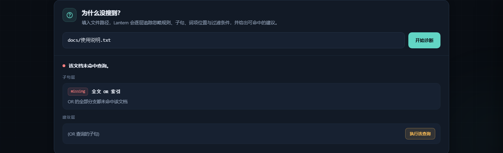

# Lantern

**零依赖、可解释的本地全文搜索引擎 —— 仅用 Go 标准库实现。**

[English README](README.md)（默认） · Go ≥ 1.22 · 无第三方模块 · 无外部网络请求


---

## 核心特性

- **分段倒排索引**：不可变段 + manifest 原子提交 + 崩溃安全恢复 + MVCC 快照 + 分层合并。
- **BM25F 排序**：跨段统计、字段加权、可选 recency 加成。
- **完整查询语法**：`AND` / `OR` / `NOT`、`"短语"`、`"邻近"~n`、`字段:`、`前缀*`、`模糊~`，以及 `ext:` / `size:` / `mtime:` 过滤。
- **Explain**：每条结果都能展开为逐词项贡献，Σ 贡献与总分之差 < `1e-9`（测试强制）。
- **Why-not**：解释某个文档为何未命中（忽略规则、编码、最近词、短语顺序与间隔、`NOT` 触发、过滤失败），并建议移除哪个子句即可命中。
- **中文与代码友好**：CJK 二元组 + 单字包含匹配、`camelCase` / `snake_case` 标识符子词、全角折叠。
- **内嵌网页界面**：单文件 HTML，中英双语切换、明暗主题、即输即搜、得分拆解、原文查看与未命中诊断；零外部资源。



---

## 安装

```bash
go build -o lantern ./cmd/lantern      # 或 make build -> bin/lantern
```

`go.mod` 只有 `module` 与 `go` 两行，没有 `require`，无需下载任何依赖。

## 快速上手

```bash
lantern index docs                    # 扫描并增量索引（--workers N --max-size 2MB --no-store-body）
lantern search "搜索引擎"              # 中文二元组命中
lantern search '"http request"'       # 短语命中 parseHTTPRequest（标识符子词）
lantern search "title:alpha pre* fuzzy~ ext:md size:<1mb mtime:>2025-01-01"
lantern search "release" --explain    # 输出得分逐项拆解
lantern why-not "release" docs/a.md   # 解释 a.md 为何未命中
lantern stats                         # 文档数 / 词项数 / 段数 / 磁盘占用 / 平均字段长度
lantern check                         # 校验段 CRC 与 manifest 一致性
lantern compact                       # 强制合并为单段
lantern serve --addr 127.0.0.1:7700   # HTTP API + 内嵌界面：http://127.0.0.1:7700/
lantern watch docs --interval 2s      # 轮询增量更新（Ctrl-C 优雅退出）
```

索引目录默认是 `./.lantern`，可用 `--index <dir>` 或环境变量 `LANTERN_DIR` 覆盖；
文档路径相对**索引目录的父目录**（基目录）。退出码：`0` 成功、`1` 运行错误、
`2` 用法 / 查询语法错误（带列号指示）。

> `serve` 只在启动时打开一次索引。如果另一个进程对同一目录重新索引或合并，
> 需要重启 `serve` 才能加载新的 manifest 版本。

## 查询语法

| 形式 | 示例 | 含义 |
| --- | --- | --- |
| 隐式 / 显式 AND | `alpha beta`、`alpha AND beta` | 两个子句都要命中 |
| OR / NOT | `alpha OR beta`、`-draft`、`NOT draft` | 并集 / 排除 |
| 短语 | `"倒排索引"` | 词项顺序相邻 |
| 邻近 | `"release notes"~3` | 词项间隔不超过 3 个位置 |
| 字段限定 | `title:alpha`、`body:release`、`path:docs` | 只在指定字段检索 |
| 前缀 | `parse*` | 前缀展开 |
| 模糊 | `releas~`、`releas~/1`、`releas~/2` | 编辑距离展开 |
| 过滤 | `ext:md`、`size:>1mb`、`size:<=10kb`、`mtime:>2025-01-01`、`mtime:2025-06` | 元数据过滤 |

中文按相邻二元组加单字建立索引，因此 `搜索引擎`、单字 `擎`、中英混排 `Go语言并发`
都能命中。多字中文序列按二元组短语求值；按设计决策 D13，短语只作为匹配条件、贡献 0 分，
因此纯短语查询按路径排序；单字查询与布尔组合查询正常打分。

## 命令参考

| 命令 | 主要参数 |
| --- | --- |
| `index <dir...>` | `--workers N`、`--max-size 2MB`、`--no-store-body` |
| `watch <dir...>` | `--interval 2s`、`--workers N`、`--max-size 2MB`、`--no-store-body` |
| `search "<query>"` | `-n 10`、`--json`、`--explain`、`--no-color`、`--recency 0.2`、`--half-life 30d` |
| `why-not "<query>" <path>` | `--json` |
| `serve` | `--addr 127.0.0.1:7700` |
| `stats` / `check` / `compact` | — |
| `help` | — |

全局参数：`--index <dir>` / `LANTERN_DIR`。flag 可出现在任意位置，`-flag` 与 `--flag` 均可。
非法数值（例如 `-n 0` 或 `-n --json`）会以退出码 `2` 报错，而不是静默回退到默认值。

## HTTP API

所有接口**只读**，仅接受 `GET` / `HEAD`；其他方法返回 `405` 并带 `Allow` 头。

```
GET /api/search?q=&n=&explain=1     # 命中 + 片段 + 高亮 + 可选 explain
GET /api/why-not?q=&path=           # 结构化诊断
GET /api/doc?path=                  # 仅返回索引内已有路径的存储正文
GET /api/stats                      # docs / terms / segments / bytes / avg_len
GET /healthz                        # {"status":"ok"}
GET /                               # 内嵌网页界面
```

`/api/search` 的 `n` 取值范围 `1..100`（默认 `10`），支持 `explain=1` 或 `explain=true`，
并返回 `took_ms`。高亮区间使用 **UTF-16 code unit** 偏移，可直接用于
`String.prototype.slice`，中文与 emoji 均不会错位。

## 网页界面

执行 `lantern serve` 后打开 `http://127.0.0.1:7700/`。界面是单个内嵌 HTML 文件，
CI 会检查其中不含任何外部资源引用。

- EN / 中文语言切换、深色 / 浅色主题，选择会保存在本地。
- 即输即搜（140ms 去抖）、过期响应丢弃、加载骨架 / 空状态 / 错误态。
- 命中高亮片段、逐词项得分条、原文抽屉，以及键盘操作
  （`/` 聚焦、`↑` `↓` 选择、`Enter` 展开、`Esc` 关闭）。
- 结构化 why-not 诊断，建议可一键「执行该查询」。

可用深链：`?lang=en|zh`、`?theme=dark|light`、`?q=<查询>`、`?wn=<路径>`、
`?open=1`（展开第一条得分拆解）、`?scroll=diagnose`。

## 设计取舍

- **段不可变 + manifest 原子 rename**：一次 `rename` 即提交点；崩溃后重开必为旧版本或
  新版本之一（提交协议每一步都有故障注入测试）。
- **匹配与打分分离**：迭代器树（leapfrog / 跳块）负责高效匹配，plan 树对命中文档递归
  求值，保证 `OR` 分支得分语义与暴力 oracle 严格一致。
- **合并 = 存储正文重放分析**：避免跨段 docID 重映射，分析是确定性纯函数。
- **先汇总跨段统计再打分**：同一语料在不同分段配置下得分逐位一致。
- **JSON 元数据不加二进制 footer**：完整性由原子 rename、manifest 校验和与
  `state_len` 有效前缀共同保证。

字节布局、决策记录、里程碑进度与实测基准见
[docs/ARCHITECTURE.md](docs/ARCHITECTURE.md)、[DECISIONS.md](DECISIONS.md)、
[PROGRESS.md](PROGRESS.md) 与 [BENCH.md](BENCH.md)。

## 测试与 CI

```bash
make check          # gofmt + vet + go test ./... + UI + 文档检查
go test -race ./... # 竞态检测
make cross          # CGO_ENABLED=0 交叉编译 windows / darwin / linux
make fuzz-short     # 三个 fuzz 目标，各 20s
bash scripts/demo.sh
```

[GitHub Actions 工作流](.github/workflows/ci.yml) 在 Linux 上执行同样的门禁，并额外运行
Windows 测试任务；同时校验 `go.mod` 无 `require`、内嵌 UI 无外部资源且包含中英双语、
两份 README 各自引用对应语言的截图。差分测试（5 种子 × 3 分段配置 × 40 随机查询）
与独立暴力 oracle 比对结果集和分数；崩溃注入覆盖提交协议的每一步。

## 限制（非目标）

不支持 PDF 解析、向量 / 语义检索、分布式、多用户权限、正则搜索、以及 GBK 等非 UTF-8
编码的解码（这类文件会被计数并跳过）。Windows 下 ANSI 高亮自动降级，目录 `fsync` 为
no-op（NTFS 元数据日志，见 DECISIONS.md D2）。

## Security

Lantern is a local, read-only search service and is **not** designed to be exposed directly
to the public internet.

- `serve` binds to `127.0.0.1` by default; the HTTP layer is read-only and all API endpoints
  are restricted to `GET` / `HEAD`.
- `/api/doc` only returns paths already present in the index, so path traversal cannot read
  arbitrary files from disk.
- Every response sets `Content-Security-Policy`, `X-Content-Type-Options: nosniff`,
  `X-Frame-Options: DENY`, `Referrer-Policy: no-referrer` and a restrictive
  `Permissions-Policy`. API responses are marked `Cache-Control: no-store`.
- The embedded UI makes no external network requests, loads no remote fonts, scripts or
  images, and is checked for that in CI.
- Read, write and idle timeouts are configured so slow clients cannot hold connections open.
- There are no third-party dependencies, no telemetry and no credentials stored by Lantern.

To report a vulnerability, open an issue with a minimal reproduction. Please do not include
private document contents. If you need remote access, put Lantern behind an authenticated
reverse proxy with TLS.

## License

MIT License — see [LICENSE](LICENSE). Copyright (c) 2026 Lantern contributors.
